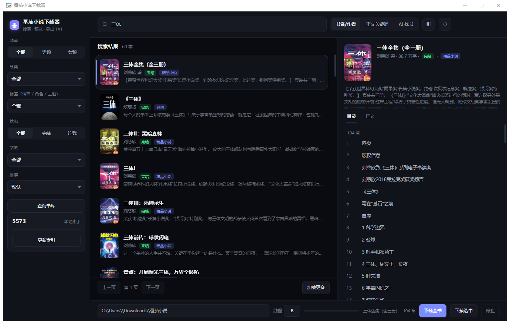

# 番茄小说下载器

带图形界面的番茄免费小说下载工具：**搜索 → 预览 → 导出 TXT**。

界面用 **WebView + HTML/CSS** 渲染（不是 tkinter），所以有真正的圆角、阴影、hover、按下反馈和入场动效；深色/浅色可切换，书籍卡片带封面、完结徽章、分类标签。



## 功能

- **搜索**：番茄官方轻量搜索接口（免签名），一次 60 本，「加载更多」继续翻页
- **AI 找书**：一句话描述想看的故事（「无限流闯关、带规则怪谈」），AI 拆关键词 → 检索 → 按简介精排并给理由
- **按标签找书**：频道、36 个主分类、224 个细分标签、状态、字数、排序、翻页
- **预览**：目录里点章节，右侧直接读正文（保留缩进，图片位置标 `[图片]`）
- **下载**：并发抓取，输出单个 txt，支持中断续传、付费章节自动跳过
- **本地索引**：书库书单快照到 SQLite，搜索/离线兜底

## 安装

需要 Python 3.9 以上 + Windows 10/11（自带 WebView2 运行时）。

```bash
pip install pywebview
```

双击 `启动.bat`（会检查并自动安装依赖），或 `python 番茄小说下载器.py`。

## 使用

1. 顶部输入书名/作者，回车（也可直接粘贴书籍链接或书号）
2. 列表里点一本书 → 右侧出封面、简介和目录
3. 点章节看正文；「下载全书」导出 txt
4. 想按题材浏览就点左侧「查询书库」
5. 想用自然语言找书，模式切「AI 找书」（先在 ⚙ 里填 DeepSeek Key）

## 架构

```
┌────────────────────┐    HTTP/JSON     ┌──────────────────┐
│  WebView (HTML/CSS │  ←────────────→  │  Python 后端     │
│  /JS 界面)          │  127.0.0.1:8731  │  抓取/解密/下载   │
└────────────────────┘                  └──────────────────┘
```

界面和逻辑通过本机 HTTP 通信（`/api/search`、`/api/detail`…），不依赖 WebView 的 JS 桥，稳定性更好；进度用轮询 `/api/progress`。

| 环节 | 做法 |
| --- | --- |
| 搜索 | `novel.snssdk.com/api/novel/channel/homepage/search/search/v1/`（官方免签名，`aid=1967&q=&offset=`） |
| 目录 | `/api/reader/directory/detail?bookId=` |
| 书籍信息 | 书籍页 `window.__INITIAL_STATE__.page`（明文） |
| 正文 | 章节页 `reader.chapterData.content` |
| 正文反混淆 | 私有区编码（U+E000–U+F8FF）+ 配套 woff2 字体。内置两张还原表：**正文表**和**书库表**（映射完全不同），按字体 sha1 缓存 |
| 书库列表 | `/api/author/library/book_list/v0/`，文本同样是混淆的，用书库表解码 |
| 封面 | 官方 `p*-tt.bytecdn.cn` 有防盗链，换成 `p3-novel.byteimg.com` |
| AI 找书 | DeepSeek `chat/completions`（JSON 模式）两次调用：拆关键词、按简介精排 |
| 本地索引 | SQLite（`.cache/library.db`） |

## 实测

- 搜「三体」60 本，封面全部加载；点「加载更多」到 120 本
- 「斗罗大陆」「诡秘之主」「剑来」都能直接命中
- 8 线程下载 40 章 1.8 秒；抽查章节字数与官方完全一致
- 成品 txt 中混淆字符残留 0

## 限制

- 只能下载免费章节
- 搜索结果里有个别已下架/仅 App 可见的书，点开会自动跳过
- 书库接口有频率限制，索引可能分几次抓完（自动断点续传）

## 目录结构

```
番茄小说下载器.py      后端 + HTTP 服务 + WebView 启动
ui/index.html          界面（CSS/JS 内联的单文件）
启动.bat               启动脚本（检查 pywebview）
assets/fontmap.json    两套字体还原表
assets/categories.json 标签体系缓存
.cache/library.db      本地索引
```

## License

MIT
