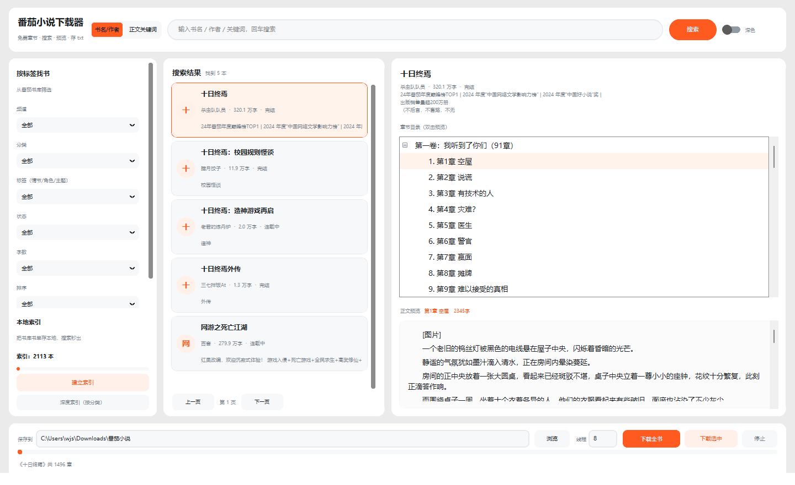

# 番茄小说下载器（桌面版）

**搜索 → 预览 → 下载成 txt**，带本地索引，搜书秒出。



## 启动

双击 **启动.bat**（首次会自动装界面组件 customtkinter）。

窗口三栏：

- **左**：按标签找书（频道/分类/标签/状态/字数/排序）+ 本地索引管理
- **中**：书籍卡片列表，点一下自动加载目录
- **右**：章节目录 + 正文预览

右上角可切深色模式。

## 搜索为什么改成"本地索引"

番茄的网页搜索接口 `/api/author/search/search_book/v1` 现在对**所有客户端**都返回空
（我用真实浏览器打开搜索页，页面自己显示"共 0 项相关的结果"），这条路走不通。
搜索引擎只能索引到少量书，所以会出现"搜不到大部分书"。

现在改用**书库全量索引**：

1. 番茄书库接口 `/api/author/library/book_list/v0/` 可以按页列出全部书（每页 18 本，共约 556 页）。
2. 点「建立索引」→ 程序把这些书单抓下来，用内置的书库字体表解码书名/作者/简介，存进本地 SQLite。
3. 之后在搜索框输入任何书名、作者、简介关键词，**直接查本地库**，毫秒级出结果，不再依赖任何外部服务。

- 完整索引约 1 万本，正常速度 3–5 分钟；接口有频率限制，被限流时会自动停下并记住进度，再点一次接着抓。
- 「深度索引」会再按 36 个主分类各扫一遍，覆盖更多书（耗时更长）。

## 三种找书方式

| 方式 | 说明 |
| --- | --- |
| 搜书名/作者 | 查本地索引（含简介关键词），没有索引时会先自动建一次 |
| 正文关键词 | 先查索引，再尝试搜索引擎找正文页 |
| 按标签筛选 | 实时调书库接口：范围 + 排序 + 翻页 |

标签体系（实测）：主分类 36 个、情节 127 个、角色 52 个、主题 45 个。

## 预览与下载

- 目录里双击一章 → 右栏显示正文（保留段落缩进，图片位置标 `[图片]`）。
- 「下载全书」/「下载选中」（Ctrl 多选）：并发下载，生成 `书名.txt`（简介 + 分卷 + 全部章节）。
- 付费章节自动跳过；中途「停止」会保留缓存，下次续传。

## 实测

- 索引 2113 本后，搜「十日终焉」5 本、搜「天蚕土豆」1 本、搜「赘婿」9 本，毫秒返回。
- 8 线程下载 40 章 1.8 秒（约 1300 章/分钟）。
- 抽查章节，解析字数与官方字数完全一致；成品 txt 中字体混淆字符残留 0。

## 实现要点

| 环节 | 做法 |
| --- | --- |
| 目录 | `/api/reader/directory/detail?bookId=` |
| 书籍信息 | 书籍页 `window.__INITIAL_STATE__.page`（明文） |
| 正文 | 章节页 `reader.chapterData.content` |
| 正文反混淆 | 番茄把字换成私有区编码（U+E000–U+F8FF），用配套 woff2 字体渲染。程序内置两张表：正文表、书库表（**两套映射完全不同**），按字体 sha1 缓存在 `assets/fontmap.json` |
| 书库列表 | `/api/author/library/book_list/v0/`，返回文本同样是混淆的，用书库表解码 |
| 本地索引 | SQLite（`.cache/library.db`），字段：书号/书名/作者/简介/字数/状态 |
| 字体更新兜底 | 表对不上时自动下载新字体并做字形位图比对重建（需 `pip install pillow fonttools brotli numpy`） |

## 目录结构

```
番茄小说下载器.py     主程序
启动.bat              启动（会检查/安装 customtkinter）
assets/fontmap.json   两套字体还原表缓存
assets/categories.json 标签体系缓存
.cache/library.db     本地书籍索引
.cache/               章节缓存、书籍信息缓存
下载/                 默认输出目录
```

## 已知限制

- 只能下免费章节。
- 书库接口有频率限制：索引可能分几次抓完（会自动断点续传）。
- 索引覆盖"番茄书库列出的书"；未进书库的书只能用书名精确搜索引擎兜底。
